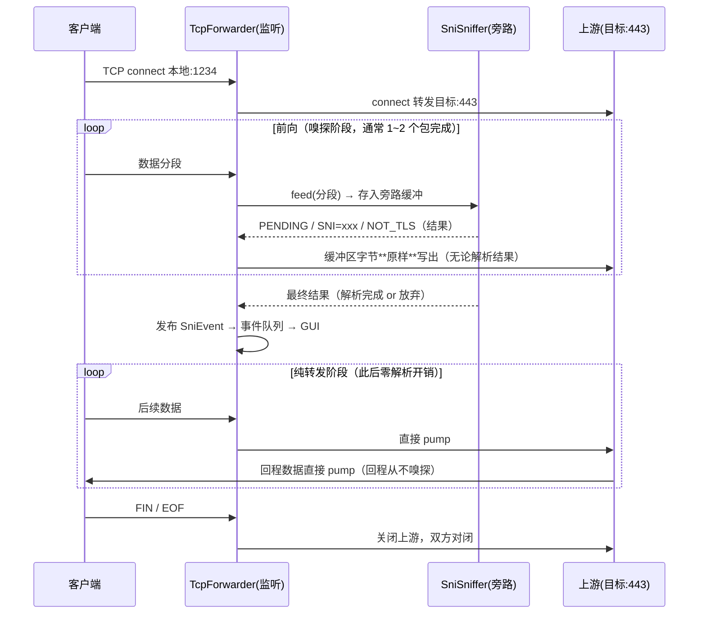
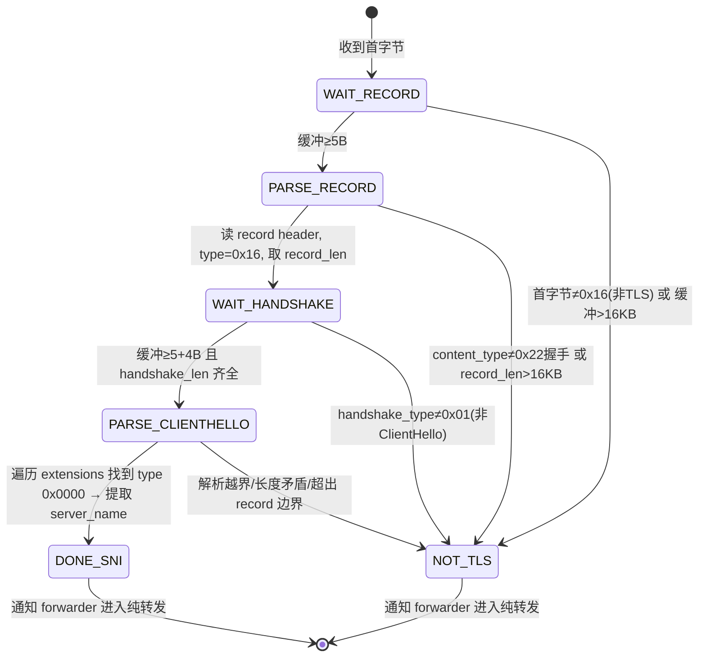
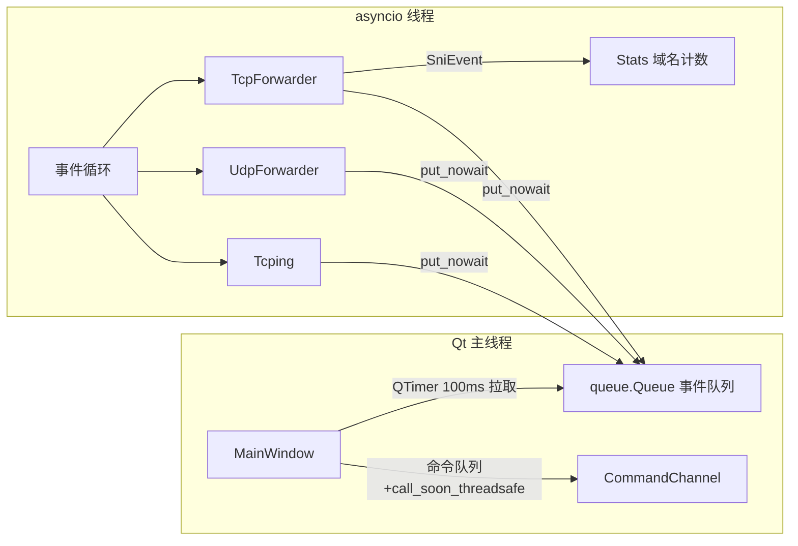

# SNI 域名探测器（SNI-Tap）架构设计文档 v1

> 状态：**设计定稿**（2026-11-03 用户已确认四项决策，见第 8 节）
> 产出：软件公司专家团 · 架构师 高见远（Gao）｜汇编：交付总监 齐活林（Qi）
> 日期：2026-11-03

---

## 1. 技术选型

### 主推荐：Python 3.11+ asyncio + PySide6

| 评估点 | 结论 |
|---|---|
| TCP 长连接双向转发 | `asyncio.start_server` + `StreamReader/Writer`，双向 `drain/pump` 是最成熟的方案，无需手写 select |
| UDP 数据报转发 | `loop.create_datagram_endpoint` + `DatagramProtocol`，天然支持「每个客户端地址一个上游 socket」的映射模型 |
| TLS ClientHello 嗅探 | 纯字节操作（`memoryview` + 手工解析），SNI 解析与转发彻底解耦；asyncio 的流式读取天然支持「先缓冲、解析、再整体转发」的旁路模式 |
| GUI 与网络线程模型 | GUI 主线程 + asyncio 专用线程；跨线程用 `queue.Queue` 事件投递 + Qt `QTimer` 轮询，最简单可靠、无信号槽跨线程坑 |
| 打包分发 | PyInstaller `--onefile` 单 exe，PySide6 已被良好支持；仅 1 个第三方依赖（PySide6），解析全部手写 |

一句话理由：**网络需求（TCP 流 + UDP 数据报 + 流式嗅探）全是 asyncio 原生强项，用户熟悉 Python，PySide6 满足高 UI 要求且打包成熟。**

### 备选

| 方案 | 优点 | 不选为主因 |
|---|---|---|
| 备选 A：Python + tkinter | 零第三方依赖 | UI 观感与布局能力弱，与用户对 UI/UX 的高要求冲突 |
| 备选 B：Node.js + Electron | 用户熟悉 JS；net/dgram 即够用 | 包体 80MB+、内存占用高，对这种小工具过度 |

> SNI 解析器完全手写（约 150 行），不引入 scapy/dpkt/pyshark 等重依赖——它们面向抓包场景，对「单条流旁路解析」反而笨重且带风险。

---

## 2. v1 范围界定（含合理性确认）

| 项 | v1 决策 |
|---|---|
| TCP | 转发 + TLS ClientHello SNI 嗅探 ✅ |
| UDP（QUIC/HTTP3） | **仅透明转发，不嗅探 SNI** ✅ |

**确认：此界定合理。** QUIC 的 SNI 藏在 Initial 包加密载荷里，需按 RFC 8446 从 DCID 派生初始密钥（HKDF）再解密 ClientHello，且 QUIC 有 header protection 与密钥轮换，实现量是 TCP 侧嗅探的 5~10 倍。v1 UDP 只做透明转发即可满足「兼容 h3 流量不断流」的目标。UDP 嗅探（解 QUIC Initial）列为 v2 可选增强，架构上预留：嗅探器接口设计为按协议可插拔（UDP 转发层收到包后调用一个可为空的 `inspect(addr, data)` 钩子）。

另两个边界决策：
- **非 TLS 流量（纯 HTTP/1.1 明文等）：原样透传，零干扰**，不尝试嗅探明文 Host（保持克制，避免误判）。
- 嗅探**失败不重试不告警**，静默进入纯转发模式。

---

## 3. 模块划分与文件结构

```
SNI-Tap/
├── README.md
├── requirements.txt
├── snitap.spec                 # PyInstaller 打包配置
└── src/snitap/
    ├── __init__.py
    ├── __main__.py             # 入口：python -m snitap
    ├── config.py               # AppConfig dataclass（listen_port/target_host/target_port）
    ├── events.py               # 事件定义 + 线程桥（EventBus：asyncio→GUI 的 queue）
    ├── sni_sniffer.py          # TLS ClientHello 流式解析状态机（纯函数式，无 IO）
    ├── tcp_forwarder.py        # TCP 转发引擎（listener + 每连接 pump + 嗅探旁路）
    ├── udp_forwarder.py        # UDP 转发引擎（addr→上游 socket 映射 + 回程路由）
    ├── tcping.py               # 周期性 TCP connect 测延迟
    ├── stats.py                # 会话统计（域名计数器、连接数、嗅探总数）
    ├── worker.py               # asyncio 事件循环宿主线程（启动/停止各引擎、命令队列）
    └── gui/
        ├── __init__.py
        ├── main_window.py      # 主窗口：布局、输入框、按钮、tcping 显示
        ├── log_panel.py        # 日志区组件（环形上限 5000 行，防内存膨胀）
        └── stats_table.py      # 统计列表组件（QTableWidget，按次数排序）
```

各模块职责一句话：
- **sni_sniffer**：唯一"聪明"的模块，输入字节、输出 `SNI 域名 or None or 未决`，完全可单测。
- **tcp_forwarder / udp_forwarder**：只做 IO 和字节搬运，嗅探通过回调/钩子注入。
- **worker**：唯一拥有事件循环的类，对外只暴露 `start(config)` / `stop()` / `event_queue`。
- **gui**：只消费事件、渲染界面、发命令，不含任何网络逻辑。
- **events**：两侧共享的数据类（SniEvent / TcpingEvent / StatusEvent / ConnEvent），是解耦的契约。

---

## 4. 数据流设计

### 4.1 TCP 转发数据流（嗅探器为只读旁路）



**关键保证（零干扰）**：嗅探器**没有写路径**。每段数据先进入旁路缓冲供解析，同一份字节立即追加到上游写出队列；解析成功、失败、放弃，都不影响转发内容与时机。最坏情况仅是「多缓冲一个 ClientHello 大小的内存」（上限 16KB，见 4.2）。任一方向出错：双端同时关闭，连接计数 -1。

### 4.2 SNI 嗅探状态机



解析链路：record header（5B：type 0x16 + version 2B + length 2B）→ handshake header（4B：type 0x01 + 3B length）→ ClientHello 主体（version 2 + random 32 + session_id + cipher_suites + compression）→ extensions：循环 `type(2B) len(2B)`，命中 `0x0000` → `list_len(2) entry_type(1)=0 name_len(2) → UTF-8 域名`。

**跨段缓冲策略**：
- 前向数据全部进入旁路缓冲；每次 feed 后尝试推进状态机，字节不够则继续等下一分段（等待上限 = 单条连接首包后 10 秒，超时放弃进入纯转发）。
- **放弃条件（全部转 NOT_TLS 并清缓冲引用）**：非 0x16 首字节、缓冲超 16KB（ClientHello 实际几乎都 <4KB）、长度字段矛盾、解析越过 record 边界。
- 嗅探只发生在**每条连接的前向开头**，结果落定后该连接的解析器即被丢弃，后续流量零开销。

### 4.3 UDP 转发数据流

```
客户端 A:port ──datagram──▶ 监听 socket
                              │ 查表 addr→upstream
                              ├─ 命中 → upstream_A.sendto(data)
                              └─ 未命中 → 新建上游 socket_A(绑定随机本地端口)，
                                          注册回调: socket_A 收到回包 → 监听 socket.sendto(回包, A:port)
                                          表项记 last_seen 时间戳
后台任务：每 30s 清扫 last_seen > 60s 的表项 → close socket_A
停止时：遍历关闭全部上游 socket，清空映射表
```

映射表是唯一的 UDP 状态，单字典 + 一次清扫任务，复杂度最低。v1 表项无上限（家用场景可达），v2 可加上限 LRU。

---

## 5. 线程/并发模型



| 决策点 | 选择 | 一句话理由 |
|---|---|---|
| 事件循环位置 | **独立线程**（`worker.py` 中 `new_event_loop` + `run_forever`） | GUI 留在主线程是 Qt 铁律；隔离后 worker 可整体 create/destroy |
| 网络层→GUI | 事件对象 `queue.Queue.put_nowait`，GUI `QTimer(100ms)` 批量 drain（一次最多 200 条日志，多余的合并进统计） | 比 Qt 信号槽跨线程 emit 更可控，天然批量、天然背压 |
| GUI→网络层 | 命令对象经 `loop.call_soon_threadsafe` 投递 | 官方推荐的跨线程唤醒方式 |
| 统计数据所有权 | `Stats` 只在 worker 线程内修改；GUI 只读事件携带的**不可变快照** | 无锁设计 |

**「转发监听/停止」状态机**：
`IDLE →(点击) STARTING → RUNNING →(点击) STOPPING → IDLE`
- STARTING：按钮置灰显示"启动中…"；端口被占用（`OSError` EADDRINUSE）或目标解析失败 → 弹状态栏红色提示，回 IDLE，**不崩不退出**。
- RUNNING：三个输入框禁用（变灰）。
- STOPPING：先停 listener、再逐条关闭 TCP 连接（双方对闭）、关闭全部 UDP 上游 socket、停 tcping；完成后回 IDLE，输入框恢复可编辑。超时 2s 兜底强杀循环线程重建。

---

## 6. tcping 设计

| 项 | 设计 |
|---|---|
| 方式 | asyncio `open_connection(host, port)` 计时，**只测握手延迟，不发数据**，测完立即关闭；与转发完全独立 |
| 间隔 | 3s（目标域名每 3s 重解析一次 DNS，天然跟随 Cloudflare 优选变化） |
| 超时 | 2s 无响应 → 判定失败 |
| 显示 | 成功：`23.4 ms`（绿色）；失败：`超时`（红色）；启动中：`--` |
| 附带信息 | 状态栏显示当前解析到的目标 IP，便于确认优选是否生效 |

---

## 7. GUI 布局说明（线框图见对话内渲染稿）

```
┌──────────────────────────────────────────────────────────────┐
│ ① 配置区（水平一行，QHBoxLayout，固定高度）                      │
│  本地端口:[1234]  目标地址:[cf.090227.xyz]  目标端口:[443]      │
│  [ ▶ 转发监听 ]                                               │
│  输入框带 placeholder（空时灰字提示默认值语义），固定合理宽度      │
├──────────────────────────────────────────────────────────────┤
│ ② 状态区（一行，与配置区同高或稍矮）                              │
│  ● 监听中   延迟: 23.4 ms (→ 104.16.x.x:443)    [清除日志]     │
│  左：圆点状态灯+文字；中：tcping 大字号显示(绿色/红色)；           │
│  右：「清除日志」按钮（唯一的辅助操作，克制）                      │
├──────────────────────────────────────────────────────────────┤
│ ③ 上：域名统计（QTableWidget 2列: 域名 | 次数）                  │
│  按次数降序实时排序 · 新嗅探先入表再排序 · 双击复制单元格          │
├──────────────────────────────────────────────────────────────┤
│ ③ 下：SNI 嗅探日志（QPlainTextEdit 只读，QSplitter 垂直分割）    │
│  格式: 14:32:05  api.xx.com   · 等宽字体                        │
│  自动滚动到底 · 上限5000行,超出丢最旧                            │
├──────────────────────────────────────────────────────────────┤
│ ④ 状态栏: 状态|TCP连接数|UDP映射数|嗅探总数|目标 xxx:443          │
└──────────────────────────────────────────────────────────────┘
```

布局要点：
- **主区上下分割（QSplitter 垂直方向，可拖动）**【用户已确认】：**统计表在上（约 40%），滚动日志在下（约 60%）**；统计常驻顶部一眼可见，日志大视野居下滚动。
- 时间戳格式 `HH:mm:ss`（当天日期无信息量）；统计列表双击可复制域名。
- 运行中：输入框禁用、按钮文字变「■ 停止」（红调）；停止后恢复。
- v1 **不做**日志导出、不做设置持久化、不做托盘——保持克制，列为待确认项。

---

## 8. 决策记录（2026-11-03 用户已确认）

| # | 决策项 | 结论 |
|---|---|---|
| 1 | 技术选型 | ✅ Python 3.11+ asyncio + PySide6 |
| 2 | GUI 主区布局 | ✅ **上下分割**（**统计在上、滚动日志在下**，QSplitter 垂直可拖动） |
| 3 | UDP 嗅探范围 | ✅ v1 仅透明转发，QUIC SNI 嗅探留 v2 可插拔钩子 |
| 4 | 日志导出 | v1 不做（保持克制，v2 再加） |
| 5 | 非 TLS 流量 | 明文 HTTP 不嗅探 Host、纯透传 |
| 6 | 打包 | ✅ PyInstaller 单 exe（snitap.spec） |

---

## 9. 后续任务拆分建议（确认后执行，共 4 个任务）

| ID | 任务 | 覆盖文件 | 依赖 |
|---|---|---|---|
| T01 | 项目基础设施 | requirements.txt、__init__/__main__、config.py、events.py | — |
| T02 | 网络引擎 + 嗅探 | sni_sniffer.py、tcp_forwarder.py、udp_forwarder.py、tcping.py、stats.py（含 sni_sniffer 单测） | T01 |
| T03 | worker 线程桥 | worker.py（事件循环宿主 + 命令处理 + 生命周期） | T02 |
| T04 | GUI + 集成打包 | gui/*.py、样式微调、smoke 联调、snitap.spec | T03 |

**共享约定**：所有事件为 `@dataclass(frozen=True)`；时间戳统一 `time.strftime("%H:%M:%S")` 本地时间；任何引擎异常只经 StatusEvent 上报，绝不抛入 GUI 线程。
