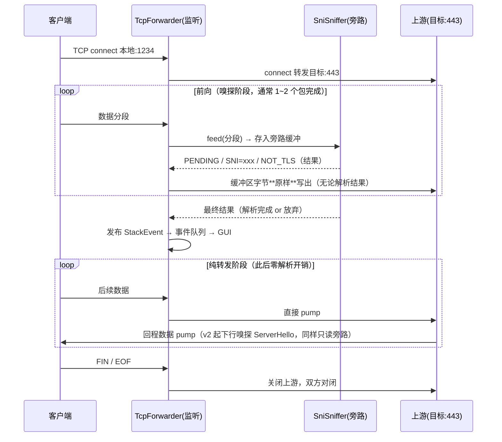
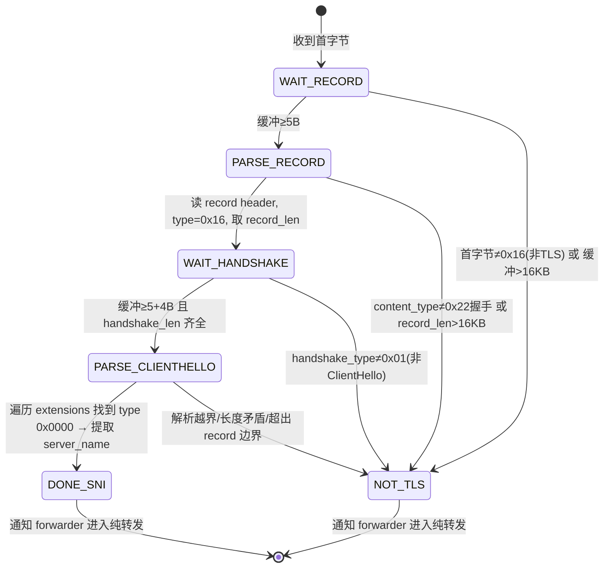
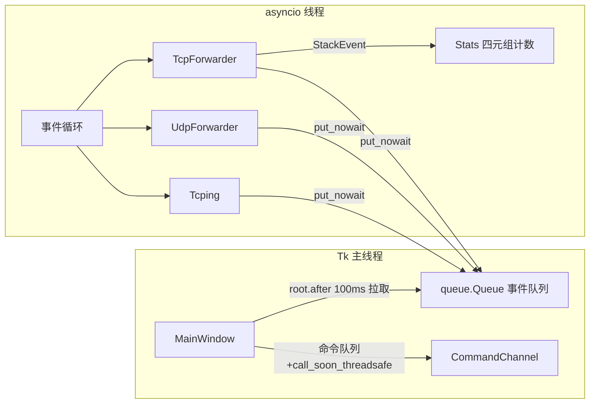

# SNI 域名探测器（SNI-Tap）架构设计文档

> 状态：v1 设计定稿（2026-11-03）+ v2 三层嗅探增量（2026-11-03，主理人审核定稿，
> 见第 10 节；与 v1 原文冲突处以第 10 节为准）
> 产出：软件公司专家团 · 架构师 高见远（Gao）｜汇编：交付总监 齐活林（Qi）
> 日期：2026-11-03

---

## 1. 技术选型

### 主推荐：Python 3.11+ asyncio + tkinter

> 迁移说明：v1 定稿时 GUI 选型为 PySide6；后因单文件 exe 达 24.7 MB，经视觉
> 样张逐像素评审后全量迁移到标准库 tkinter，exe 降至约 9.1 MB。网络层选型未变。

| 评估点 | 结论 |
|---|---|
| TCP 长连接双向转发 | `asyncio.start_server` + `StreamReader/Writer`，双向 `drain/pump` 是最成熟的方案，无需手写 select |
| UDP 数据报转发 | `loop.create_datagram_endpoint` + `DatagramProtocol`，天然支持「每个客户端地址一个上游 socket」的映射模型 |
| TLS ClientHello 嗅探 | 纯字节操作（`memoryview` + 手工解析），SNI 解析与转发彻底解耦；asyncio 的流式读取天然支持「先缓冲、解析、再整体转发」的旁路模式 |
| GUI 与网络线程模型 | GUI 主线程 + asyncio 专用线程；跨线程用 `queue.Queue` 事件投递 + `root.after(100ms)` 轮询，最简单可靠 |
| 打包分发 | PyInstaller `--onefile` 单 exe；运行时零第三方依赖（tkinter 属标准库），解析全部手写 |

一句话理由：**网络需求（TCP 流 + UDP 数据报 + 流式嗅探）全是 asyncio 原生强项，用户熟悉 Python；GUI 用标准库 tkinter 可把单文件 exe 压到 10 MB 以内。**

### 备选

| 方案 | 优点 | 不选为主因 |
|---|---|---|
| 备选 A：Python + PySide6 | UI 观感与布局能力最强（QSS 圆角、原生高 DPI、富文本表格） | 单文件 exe 24.7 MB，裁剪极限仍 23.8 MB，对一个小工具过重 |
| 备选 B：Node.js + Electron | 用户熟悉 JS；net/dgram 即够用 | 包体 80MB+、内存占用高，对这种小工具过度 |

> SNI 解析器完全手写（约 150 行），不引入 scapy/dpkt/pyshark 等重依赖——它们面向抓包场景，对「单条流旁路解析」反而笨重且带风险。

---

## 2. v1 范围界定（含合理性确认）

| 项 | v1 决策 |
|---|---|
| TCP | 转发 + TLS ClientHello SNI 嗅探 ✅ |
| UDP（QUIC/HTTP3） | **仅透明转发，不嗅探 SNI** ✅ |

**确认：此界定合理。** QUIC 的 SNI 藏在 Initial 包加密载荷里，需按 RFC 8446 从 DCID 派生初始密钥（HKDF）再解密 ClientHello，且 QUIC 有 header protection 与密钥轮换，实现量是 TCP 侧嗅探的 5~10 倍。v1 UDP 只做透明转发即可满足「兼容 h3 流量不断流」的目标。UDP 嗅探（解 QUIC Initial）列为 v2 可选增强，架构上预留：嗅探器接口设计为按协议可插拔（UDP 转发层收到包后调用一个可为空的 `inspect(addr, data)` 钩子）。

另两个边界决策：
- **非 TLS 流量（纯 HTTP/1.1 明文等）：原样透传，零干扰**，不尝试嗅探明文 Host（保持克制，避免误判）。
- 嗅探**失败不重试不告警**，静默进入纯转发模式。

---

## 3. 模块划分与文件结构

```
SNI-Tap/
├── README.md
├── requirements.txt            # cryptography>=44.0（v2 起 QUIC 解密依赖，缺失自动降级）
├── snitap.spec                 # PyInstaller 打包配置
└── src/snitap/
    ├── __init__.py
    ├── __main__.py             # 入口：python -m snitap
    ├── config.py               # AppConfig dataclass（listen_port/target_host/target_port）
    ├── protocol.py             # v2 共享契约：UNKNOWN、名称映射、ProtocolStack、StackRow
    ├── tls_sniffer.py          # TLS 双向 hello 嗅探（纯函数 + 流式外壳，v2 取代 sni_sniffer）
    ├── quic_crypto.py          # v2：QUIC Initial 密钥派生与解密（唯一 import cryptography）
    ├── quic_sniffer.py         # v2：长包头 → Initial 解密 → CRYPTO 重组
    ├── flow.py                 # v2：TcpFlow / QuicFlow 聚合器（每连接至多一条事件）
    ├── events.py               # 事件定义 + 线程桥（asyncio→GUI 的 queue）
    ├── tcp_forwarder.py        # TCP 转发引擎（listener + 每连接双向 pump + 嗅探旁路）
    ├── udp_forwarder.py        # UDP 转发引擎（addr→上游 socket 映射 + 回程路由 + 嗅探）
    ├── tcping.py               # 周期性 TCP connect 测延迟
    ├── stats.py                # 会话统计（四元组计数器、连接数、嗅探总数）
    ├── worker.py               # asyncio 事件循环宿主线程（启动/停止各引擎、命令队列）
    └── gui/
        ├── __init__.py
        ├── main_window.py      # 主窗口：布局、输入框、按钮、tcping 显示
        ├── log_panel.py        # 协议栈日志（tk.Text + tag 富文本，五段式行 + 4 条批量 tag_add）
        ├── stats_table.py      # 协议栈统计表（Canvas 自绘两行式布局，四元组聚合）
        ├── theme.py            # 暗/亮配色令牌 + 系统亮暗探测 + 字族探测
        └── widgets.py          # 共用件：DPI 缩放、极细滚动条、输入框工厂
```

各模块职责一句话：
- **protocol**：全项目唯一「未知值」（`UNKNOWN == "-"`）与名称映射来源，不依赖任何其他模块。
- **tls_sniffer / quic_sniffer**：只读嗅探，输入字节 / 数据报、输出 `HelloInfo`，
  完全可单测（QUIC 侧有独立 RFC 9001 加密夹具做端到端验证）。
- **flow**：聚合器，双向握手合并为**一条** `ProtocolStack`（决策 D1）。
- **tcp_forwarder / udp_forwarder**：只做 IO 和字节搬运，嗅探通过回调注入；UDP 先转发后嗅探。
- **worker**：唯一拥有事件循环的类，对外只暴露 `start(config)` / `stop()` / `events`。
- **gui**：只消费事件、渲染界面、发命令，不含任何网络逻辑（`LogEntry` 定义在 GUI 层）。
- **events**：两侧共享的数据类（StackEvent / TcpingEvent / StateEvent / StatsEvent / NoticeEvent），
  是解耦的契约。

---

## 4. 数据流设计

### 4.1 TCP 转发数据流（嗅探器为只读旁路）



**关键保证（零干扰）**：嗅探器**没有写路径**。每段数据先进入旁路缓冲供解析，同一份字节立即追加到上游写出队列；解析成功、失败、放弃，都不影响转发内容与时机。最坏情况仅是「多缓冲一个 ClientHello 大小的内存」（上限 16KB，见 4.2）。任一方向出错：双端同时关闭，连接计数 -1。

### 4.2 SNI 嗅探状态机



解析链路：record header（5B：type 0x16 + version 2B + length 2B）→ handshake header（4B：type 0x01 + 3B length）→ ClientHello 主体（version 2 + random 32 + session_id + cipher_suites + compression）→ extensions：循环 `type(2B) len(2B)`，命中 `0x0000` → `list_len(2) entry_type(1)=0 name_len(2) → UTF-8 域名`。

**跨段缓冲策略**：
- 前向数据全部进入旁路缓冲；每次 feed 后尝试推进状态机，字节不够则继续等下一分段（等待上限 = 单条连接首包后 10 秒，超时放弃进入纯转发）。
- **放弃条件（全部转 NOT_TLS 并清缓冲引用）**：非 0x16 首字节、缓冲超 16KB（ClientHello 实际几乎都 <4KB）、长度字段矛盾、解析越过 record 边界。
- 嗅探只发生在**每条连接的前向开头**，结果落定后该连接的解析器即被丢弃，后续流量零开销。

### 4.3 UDP 转发数据流

```
客户端 A:port ──datagram──▶ 监听 socket
                              │ 查表 addr→upstream
                              ├─ 命中 → upstream_A.sendto(data)
                              └─ 未命中 → 新建上游 socket_A(绑定随机本地端口)，
                                          注册回调: socket_A 收到回包 → 监听 socket.sendto(回包, A:port)
                                          表项记 last_seen 时间戳
后台任务：每 30s 清扫 last_seen > 60s 的表项 → close socket_A
停止时：遍历关闭全部上游 socket，清空映射表
```

映射表是唯一的 UDP 状态，单字典 + 一次清扫任务，复杂度最低。v1 表项无上限（家用场景可达），v2 可加上限 LRU。

---

## 5. 线程/并发模型



| 决策点 | 选择 | 一句话理由 |
|---|---|---|
| 事件循环位置 | **独立线程**（`worker.py` 中 `new_event_loop` + `run_forever`） | GUI 必须留在主线程（Tk 线程不安全）；隔离后 worker 可整体 create/destroy |
| 网络层→GUI | 事件对象 `queue.Queue.put_nowait`，GUI 用 `root.after(100ms)` 链式轮询批量 drain（一次最多 400 条，多余的留到下一轮） | 不依赖任何 GUI 框架的信号机制，天然批量、天然背压 |
| GUI→网络层 | 命令对象经 `loop.call_soon_threadsafe` 投递 | 官方推荐的跨线程唤醒方式 |
| 统计数据所有权 | `Stats` 只在 worker 线程内修改；GUI 只读事件携带的**不可变快照** | 无锁设计 |

**「转发监听/停止」状态机**：
`IDLE →(点击) STARTING → RUNNING →(点击) STOPPING → IDLE`
- STARTING：按钮置灰显示"启动中…"；端口被占用（`OSError` EADDRINUSE）或目标解析失败 → 弹状态栏红色提示，回 IDLE，**不崩不退出**。
- RUNNING：三个输入框禁用（变灰）。
- STOPPING：先停 listener、再逐条关闭 TCP 连接（双方对闭）、关闭全部 UDP 上游 socket、停 tcping；完成后回 IDLE，输入框恢复可编辑。超时 2s 兜底强杀循环线程重建。

---

## 6. tcping 设计

| 项 | 设计 |
|---|---|
| 方式 | asyncio `open_connection(host, port)` 计时，**只测握手延迟，不发数据**，测完立即关闭；与转发完全独立 |
| 间隔 | 3s（目标域名每 3s 重解析一次 DNS，天然跟随 Cloudflare 优选变化） |
| 超时 | 2s 无响应 → 判定失败 |
| 显示 | 成功：`23.4 ms`（绿色）；失败：`超时`（红色）；启动中：`--` |
| 附带信息 | 状态栏显示当前解析到的目标 IP，便于确认优选是否生效 |

---

## 7. GUI 布局说明（线框图见对话内渲染稿）

```
┌─────────────────────────────────────────────────────────────────┐
│① 配置区（水平一行，固定高度）                                  │
│  listen:[1234]   →   [cf.090227.xyz]           [ ▶ 转发监听 ]   │
│  目标框为 host / host:port 合一输入（端口省略默认 443）         │
│  placeholder：「host 或 host:port（端口省略默认 443）」         │
├─────────────────────────────────────────────────────────────────┤
│② 状态区（一行）                                                │
│  ● 监听中    ping 23.4ms │ peer 104.16.132.229:443   「提示」   │
│  左=状态灯+文字；ping / peer 前缀 muted、数值 green / cyan      │
│  右=notice 提示位（错误红 / 普通 muted，5s 自动消失）           │
├─────────────────────────────────────────────────────────────────┤
│③ 左：SNI 嗅探日志（tk.Text 只读，PanedWindow 水平分割）        │
│  面板头：── sni log ──（绿）  上限 5000 行（dim）  [清除]       │
│  格式: 14:32:05  api.xx.com   · 等宽字体                        │
│  自动滚动到底 · 上限 5000 行，超出丢最旧                        │
├─────────────────────────────────────────────────────────────────┤
│③ 右：域名统计（StatsTable，Canvas 自绘 3 列）                  │
│  列：域名 | 条形 | 次数 · 按次数降序 · 双击复制域名             │
│  条形 = ▮ × n（n = round(count/max×10)，至少 1）                │
│  底部 footer：total N（dim）                                    │
├─────────────────────────────────────────────────────────────────┤
│④ 状态栏: tcp N │ udp N │ sni N      Ctrl + L 清屏 · Enter 启停 │
└─────────────────────────────────────────────────────────────────┘
```

布局要点：
- **主区左右 5:5 分栏（PanedWindow 水平方向，可拖动）**【用户已确认】：**左＝SNI 嗅探日志，右＝域名统计**；两栏最小宽 280，拖动 sash 可改变比例。空态时日志区显示 dim 占位提示「等待嗅探到 SNI 域名…」。
- 时间戳格式 `HH:mm:ss`（当天日期无信息量）；统计列表双击可复制域名。
- 运行中：输入框禁用、按钮文字变「■ 停止」（红调）；停止后恢复。
- v1 **不做**日志导出、不做设置持久化、不做托盘——保持克制，列为待确认项。

---

## 8. 决策记录（2026-11-03 用户已确认）

| # | 决策项 | 结论 |
|---|---|---|
| 1 | 技术选型 | ✅ Python 3.11+ asyncio + tkinter（v1 原定 PySide6；后因单文件 exe 24.7 MB 迁移到标准库 tkinter，降至 ~9.1 MB） |
| 2 | GUI 主区布局 | ✅ **左右 5:5 分栏**（左=sniff log，右=域名统计；PanedWindow 水平可拖动改比例，两栏最小宽 280） |
| 3 | UDP 嗅探范围 | ✅ v1 仅透明转发，QUIC SNI 嗅探留 v2 可插拔钩子 |
| 4 | 日志导出 | v1 不做（保持克制，v2 再加） |
| 5 | 非 TLS 流量 | 明文 HTTP 不嗅探 Host、纯透传 |
| 6 | 打包 | ✅ PyInstaller 单 exe（snitap.spec） |

---

## 9. 后续任务拆分建议（确认后执行，共 4 个任务）

| ID | 任务 | 覆盖文件 | 依赖 |
|---|---|---|---|
| T01 | 项目基础设施 | requirements.txt、__init__/__main__、config.py、events.py | — |
| T02 | 网络引擎 + 嗅探 | sni_sniffer.py、tcp_forwarder.py、udp_forwarder.py、tcping.py、stats.py（含 sni_sniffer 单测） | T01 |
| T03 | worker 线程桥 | worker.py（事件循环宿主 + 命令处理 + 生命周期） | T02 |
| T04 | GUI + 集成打包 | gui/*.py、样式微调、smoke 联调、snitap.spec | T03 |

**共享约定**：所有事件为 `@dataclass(frozen=True)`；时间戳统一 `time.strftime("%H:%M:%S")` 本地时间；任何引擎异常只经 StatusEvent 上报，绝不抛入 GUI 线程。

---

## 10. v2 增量：三层协议嗅探 + 四元组统计（2026-11-03 主理人审核定稿）

> 本章是 v2 实现的权威描述；与 v1 原文冲突处（如「UDP 仅透明转发」、
> 「回程从不嗅探」）以本章为准。完整实现规格见 `.workbuddy/tmp/arch-v2-stack.md`
> （含 FIX-1~FIX-6 主理人审核修正）。

### 10.1 需求与核心决策

三条硬需求：
1. 引入 `cryptography`（仅 QUIC 解密用）；
2. 嗅探日志每行带**应用层 / 传输层 / 安全层**的值；
3. 统计聚合键 = `(域名, 应用层, 传输层, 安全层)`，任一层不同即独立成行。

| 决策 | 内容 |
|---|---|
| D1 | **每连接/每会话只发一条事件**。`TcpFlow` / `QuicFlow` 聚合器在嗅探窗口闭合时（双向 finished / 连接关闭 / 3s backstop）合并成一条 `ProtocolStack`，避免「客户端最高支持」与「实际协商」各入库一次把统计灌脏 |
| D2 | TLS 解析拆成「纯函数 + 有状态外壳」；QUIC 的握手无 5 字节 record 头，但 handshake 编号一致，直接复用 `parse_hello` 纯函数 |
| D3 | QUIC 只解 Initial，但**双向都解**。服务端 Initial 用「客户端首个 Initial 的 DCID」派生密钥（`server in` 标签）——这是 h3 唯一能拿到协商值的路径。Handshake / 1-RTT 全加密，不碰 |
| D4 | `cryptography` 声明为依赖，代码里优雅降级。`quic_crypto.available()` 懒加载探测；缺失时 QUIC 仍输出传输层值（`QUIC/v1`），其余为 `-`，不崩不噪音 |
| D5 | 统计表用「行内两行」布局：第一行 域名+条形+次数，第二行全宽 dim 摘要 `app · transport · security`；行高 24→40 |

合并规则：拿到 ServerHello（或服务端 Initial）→ 三层取**协商值**，`provisional=False`；
只拿到客户端方向 → 退回客户端偏好，`provisional=True`，日志行尾加 `?`。
`provisional` 与各 `*_source` **不进统计键**——统计表是聚合真值，日志是单次观测。

### 10.2 三层模型

| 层 | 取值 | 来源 |
|---|---|---|
| 应用层 | ALPN（`h2` / `h3` / `http/1.1` …；未知 `-`） | ClientHello / ServerHello 的 ALPN 扩展 |
| 传输层 | `TCP` / `QUIC/v1` / `QUIC/v2` / `QUIC/draft-29` / `QUIC/vneg` / `QUIC/-` / `UDP` | 连接类型 + QUIC 长包头版本；禁止裸 `QUIC` |
| 安全层 | `TLS1.3/A128GCM` 等；cipher 未知时只留版本 | hello 的版本 + 套件（TLS1.3 五套收录短名，1.2 走 `0x%04x` 保单射） |

未知占位符全项目唯一：`protocol.UNKNOWN == "-"`。名称表必须单射，
否则「任一层不同即分开统计」会被短名合并破坏。

### 10.3 QUIC Initial 解密管线

```
UDP 数据报 → 长包头判型（long+fixed 且类型 00）
  → version==0 → 版本协商包，记 vneg，完成
  → parse_long_header（DCID/SCID/token(varint!)/length）
  → 密钥：客户端包用自身 DCID（client in）；服务端包用客户端首个 Initial 的 DCID（server in）
  → header protection（FIX-1）：先 XOR 还原 first byte，PN 长度取还原值低 2 位；
    AAD = 还原后的 first byte + 头部 + 还原后的 PN 字节
  → AES-GCM 解密 → 帧扫描（ACK 全 varint；CONNECTION_CLOSE 直接终止不解析，FIX-2）
  → CRYPTO 乱序重组（offset 连续追加、乱序暂存 ≤16KB、超限放弃）
  → 凑满 handshake 消息 → parse_hello 纯函数解析
```

尝试上限 `MAX_ATTEMPTS=4`：喂入 4 个报文仍无果即放弃（info 为 None）。
自加密夹具**独立按 RFC 9001 附录 A 实现**，绝不反向调用被测解密函数，防假通过。

### 10.4 事件与统计

- `SniEvent` → `StackEvent(ts, stack)`；`StatsEvent` 改为
  `rows: tuple[StackRow, ...]` + `distinct` + `truncated`；
- `Stats`：`Counter[tuple]`，`add_stack` / `snapshot_rows`；
  排序键 `(-count, domain, app, transport, security)` 全字段参与，快照逐帧稳定；
- 上限 `Stats.MAX_ROWS = 300`，超出截断并在 footer 标注。

### 10.5 GUI 变化

- 日志行五段式：`ts  domain  app  transport  security`（两空格分隔，不做列对齐填充）；
  tag 映射 `ts/transport→dim`、`domain→cyan`、`app→muted`、`security→green`；
  整块 insert 一次 + **4 条批量 `tag_add`**（dim 合并两个区间），禁止逐行打 tag；
- `LogEntry` 定义在 `log_panel.py`（FIX-4），`main_window._drain_events` 负责投影；
- 统计表 `set_domains` → `set_rows`，两行式绘制；截断缓存拆 `_domain_cache` /
  `_caption_cache` 各自失效，超 4096 条整体清空；
- 双击复制 TSV：`domain\ttransport\tapp\tsecurity`（可直接粘进 Excel）；
- footer：`total N · M 组`，truncated 时追加 `· 仅显示前 300 组`；
- 面板头 `── sni log ──` → `── stack log ──`，占位文案「等待嗅探到 TLS 握手…」。

### 10.6 打包变化

`cryptography` 进入运行时依赖：`snitap.spec` 解除 `ssl/_ssl/_hashlib` 排除，
`hiddenimports` 显式声明 cryptography 懒加载子模块；单文件体积预期
9.1 MB → 14~16 MB。`requirements.txt` 按 FIX-3 写 `cryptography>=44.0`（不设上限）。

### 10.7 v2 范围外（已决策）

| 事项 | 理由 |
|---|---|
| JA3 客户端指纹 | 本质是客户端指纹而非三层值之一，塞进四元组破坏「层」语义；列为 P2 储备 |
| 明文 HTTP 的 `Host:` 嗅探 | 沿用 v1 决策；会打开「非 TLS 不误报」的边界 |
| QUIC Handshake / 1-RTT 包 | 全加密，需 TLS 握手密钥，收益/风险比极差 |
| 应用层除 ALPN 外的信息 | TLS/QUIC 上应用层协议的可靠判据只有 ALPN；HTTP/2 HPACK 不可旁路解 |
